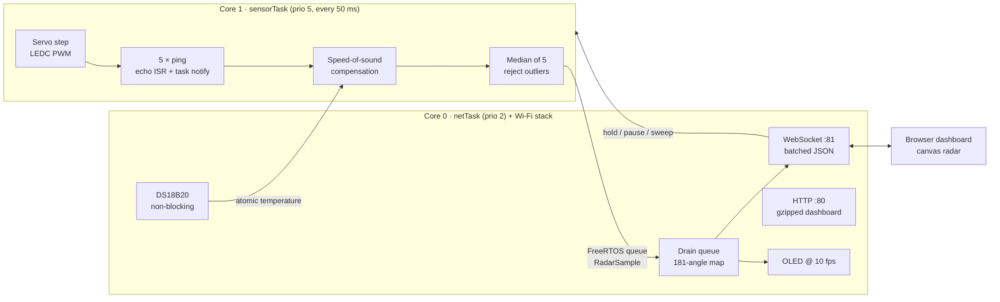

# Ultrasonic Scanning Radar with Live Web Display

**ESP32 · FreeRTOS · C++ · JavaScript**

A servo-swept HC-SR04 ultrasonic sensor scans 0–180° and draws a radar-style
sweep on a 128×64 I2C OLED and on a browser dashboard streamed live over
Wi-Fi WebSockets.

- **Two FreeRTOS tasks pinned to separate cores**: sensing on core 1, networking
  on core 0. The scan holds a steady **20 Hz** (one filtered reading per 50 ms
  step) while the ESP32 serves the web page.
- **±1 cm target accuracy from 5–150 cm**: the speed of sound is compensated with
  live DS18B20 temperature readings, and each reading is the **median of 5
  pings**, which rejects echo outliers. Accuracy is checked against a
  tape-measure fixture with the dashboard's built-in accuracy test.


---

## Hardware

| Part | Notes |
|---|---|
| ESP32 DevKit (ESP32-WROOM-32) | any dual-core ESP32 board |
| HC-SR04 ultrasonic sensor | 5 V part; ECHO needs a divider (below) |
| SG90 / MG90S micro servo | sensor mounted on the horn |
| DS18B20 temperature sensor | TO-92 or waterproof probe, 4.7 kΩ pull-up |
| SSD1306 128×64 I2C OLED | address 0x3C |
| 1 kΩ + 2 kΩ resistors | 5 V → 3.3 V divider for ECHO |
| 5 V supply ≥ 1 A | the servo draws current spikes; add 470 µF across its supply |

### Wiring

| Signal | ESP32 pin | Notes |
|---|---|---|
| HC-SR04 TRIG | GPIO 5 | 3.3 V logic triggers the HC-SR04 reliably |
| HC-SR04 ECHO | GPIO 18 | **through a 1 kΩ / 2 kΩ divider** (5 V → 3.3 V) |
| Servo signal | GPIO 13 | servo power from 5 V, common ground |
| DS18B20 DQ | GPIO 4 | 4.7 kΩ pull-up to 3.3 V |
| OLED SDA | GPIO 21 | |
| OLED SCL | GPIO 22 | |
| HC-SR04 VCC, servo V+ | 5 V | |
| OLED VCC, DS18B20 VDD | 3.3 V | |

All pins are set in [`include/config.h`](include/config.h).

```
   ECHO (5 V) ──[1 kΩ]──┬── GPIO 18
                        │
                      [2 kΩ]
                        │
                       GND
```

---

## Build and flash

Uses [PlatformIO](https://platformio.org/) (VS Code extension or CLI).

```bash
git clone https://github.com/IanL1COMPENG/Ultrasonic-Scanning-Radar-with-Live-Web-Display.git
cd Ultrasonic-Scanning-Radar-with-Live-Web-Display
cp include/secrets.example.h include/secrets.h   # then put your Wi-Fi name/password in it
pio run -t upload
pio device monitor
```

The serial monitor prints the dashboard address:

```
[wifi] dashboard: http://192.168.1.42/  (http://radar.local/)
```

The OLED also shows the IP for the first 8 seconds. Open it in any browser on
the same network.

**No Wi-Fi configured, or it can't connect?** The ESP32 starts its own access
point `UltrasonicRadar` (password `radar1234`). Join it and open `http://192.168.4.1/`.

The dashboard is gzipped into flash at build time (`tools/embed_web.py`), so
there's no filesystem image to upload.

### Try the dashboard without hardware

Open `web/index.html` straight from disk (or add `?demo` to the URL). It runs
a simulator that mimics the firmware: same sweep, same 5-ping median, same
WebSocket messages, a 15° beam cone, multipath outliers and a moving target.

To develop the page against a real device, serve `web/` locally and open
`index.html?host=192.168.1.42`.

---

## Architecture



### Why the work is split this way

- **Sensing owns core 1.** The echo pin raises a GPIO interrupt on both edges.
  The ISR timestamps each edge with the 1 µs `esp_timer` and wakes the task
  with a direct-to-task notification. The task sleeps while the sound is in
  flight instead of spinning in `pulseIn()`, and Wi-Fi interrupts on core 0
  can't stretch the measured pulse.
- **Networking stays next to the Wi-Fi stack on core 0.** It runs HTTP,
  WebSockets, the OLED and the DS18B20. OneWire bit-banging disables interrupts
  for ~60 µs per bit, which would add up to 1 cm of error if it ran on the
  sensing core during an echo. On core 0 it can't touch the measurement.
- **The tasks share one queue and a few atomics.** There are no mutexes on the
  hot path. If the network falls behind (for example while Wi-Fi reconnects),
  the sensor drops the oldest sample, so the scan rate never depends on the
  network.

### 20 Hz timing budget

Each 50 ms step (`vTaskDelayUntil`) runs in this order:

1. Wait out any remaining servo settle time. The servo was commanded at the
   end of the previous step, so it normally settled while the task slept.
2. Fire 5 pings, timeout ≈ 9.6 ms at 165 cm (110 % of max range), with
   0.6 ms gaps. Once 3 pings have missed, the median can't be valid, so the
   remaining pings are skipped.
3. Take the median, apply calibration, push the sample to the queue.
4. Command the next servo angle and sleep.

A worst-case step with every echo near 150 cm uses about 49 ms. The dashboard
shows the measured scan rate, the worst cycle time and an overrun counter, so
the claim can be checked live.

### Accuracy pipeline

```
echo µs ──► distance = echo_µs × c(T) / 2        c(T) = 331.3 × √(1 + T/273.15) m/s
          ► 5 pings ──► median (needs ≥ 3 valid echoes)
          ► × CAL_SCALE + CAL_OFFSET_CM          (from the tape-measure fit)
```

Without compensation, a 150 cm target at 35 °C reads ~3.7 cm short if the code
assumes 20 °C. That alone breaks a ±1 cm spec. The unit tests check this case.

---

## Measuring accuracy (tape-measure fixture)

The dashboard has an **Accuracy test** panel that does the bookkeeping:

1. Fix the sensor on a rail or table edge and tape a measuring tape to the
   surface, zeroed at the transducer face.
2. Use a flat, rigid target (a book or a sheet of plywood) square to the beam.
3. Click the radar, or use the slider, to choose the angle that points at the
   target, then press **Hold**.
4. Enter the tape reading in **True cm** and press **Capture**. It records 40
   readings and reports the mean, standard deviation and error.
5. Repeat at 5, 10, 25, 50, 75, 100, 125 and 150 cm.
6. With 2 or more points, the panel fits `true = a × measured + b`. Put `a`
   and `b` into `CAL_SCALE` / `CAL_OFFSET_CM` in `include/config.h`, reflash,
   and capture again to confirm every row is within ±1 cm.
7. **Export CSV** saves the table for your records.

Record your results here:

| True (cm) | Mean (cm) | σ (cm) | Error (cm) |
|---:|---:|---:|---:|
| 5 | | | |
| 10 | | | |
| 25 | | | |
| 50 | | | |
| 75 | | | |
| 100 | | | |
| 125 | | | |
| 150 | | | |

---

## WebSocket protocol (`ws://<device>:81/`)

Device → browser (JSON text frames):

| `type` | Fields | When |
|---|---|---|
| `hello` | `fw, minRange, maxRange, step, periodMs, pings` | on connect |
| `snapshot` | `d`: 181 distances indexed by angle (`-1` = no echo) | on connect |
| `s` | `s`: `[[angle, cm, dir, validPings, seq], …]` | every new sample (batched) |
| `status` | `temp, tempValid, sos, rate, overruns, dropped, maxCycleMs, mode, hold, clients, rssi, ap, ip, uptime, heap` | every 500 ms |

Browser → device:

```json
{"cmd": "sweep"}            {"cmd": "pause"}           {"cmd": "resume"}
{"cmd": "hold", "angle": 90}                           {"cmd": "clear"}
```

HTTP: `GET /` (dashboard), `GET /api/status`, `GET /api/scan`.

---

## Tests and CI

`lib/RadarCore` holds the hardware-independent math: speed of sound, echo
conversion, median filter and sweep controller. It is header-only, so the
same code runs on the ESP32 and on the host.

```bash
pio test -e native     # 16 Unity tests on your PC
pio run -e esp32dev    # firmware build
```

GitHub Actions runs both on every push. It also syntax-checks the dashboard
JavaScript and uploads `firmware.bin` as a build artifact.

## Project layout

```
include/config.h         pins, timing, ranges, calibration
include/secrets.example.h
lib/RadarCore/           shared math (unit-tested)
src/main.cpp             creates the two pinned tasks
src/sensor_task.cpp      core 1: servo + pings + filter @ 20 Hz
src/ultrasonic.cpp       interrupt-driven HC-SR04 driver
src/servo_driver.h       LEDC servo PWM
src/net_task.cpp         core 0: Wi-Fi, HTTP, WebSocket, OLED, temperature
src/oled_view.cpp        OLED radar rendering
src/temperature.cpp      non-blocking DS18B20
web/index.html           dashboard (canvas radar, controls, accuracy test, demo mode)
tools/embed_web.py       gzips the dashboard into flash at build time
test/                    Unity tests for RadarCore
```

## Troubleshooting

- **All readings "no echo"**: check the ECHO divider and the 5 V supply to the
  HC-SR04. Some clones need 5 V on TRIG; a single transistor or a 74AHCT125
  fixes that.
- **The servo jitters or the ESP32 resets**: power the servo from a separate
  5 V rail with a large capacitor, and share ground.
- **Temperature shows "(default)"**: no DS18B20 was found. Check the 4.7 kΩ
  pull-up. The radar keeps working with 20 °C assumed and detects a sensor
  plugged in later.
- **Overruns increasing**: lower `MAX_RANGE_CM`, or raise `SCAN_PERIOD_MS`.
